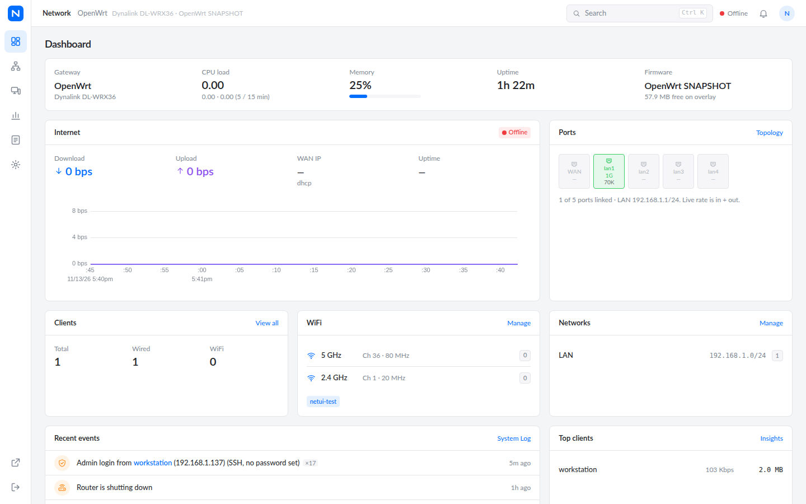
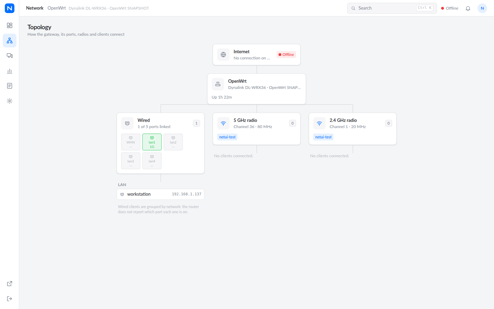
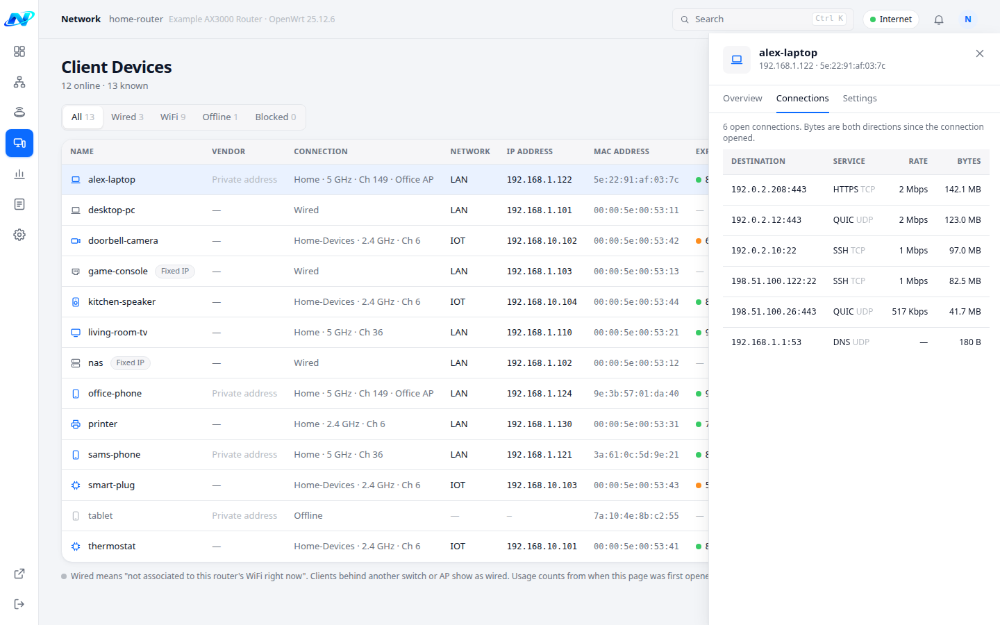
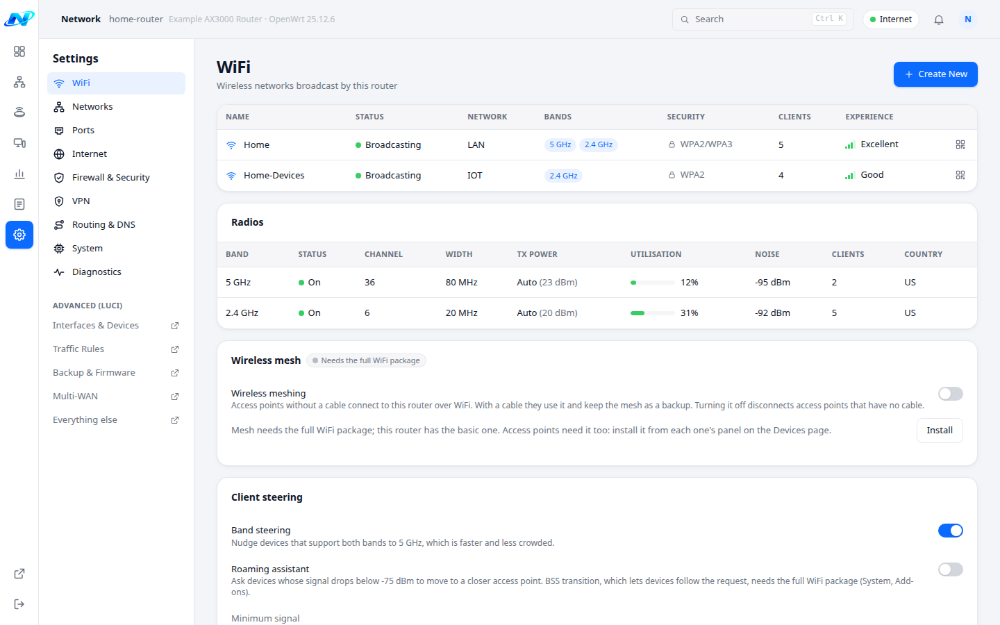
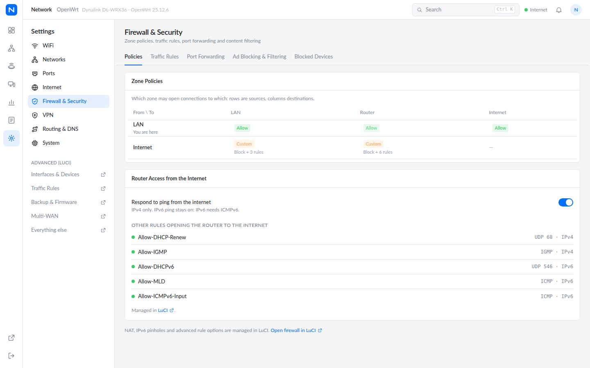

<p align="center">
  
</p>

# netui

A friendly web UI for OpenWrt routers, access points and mesh WiFi.

## Screenshots

| | |
|---|---|
|  **Dashboard**: gateway health, WAN throughput, ports, WiFi, top clients and recent events |  **Topology**: internet, gateway, ports, radios and the clients on each |
|  **Client devices**: live activity, usage and open connections per client |  **Insights**: channel utilisation, nearby networks per channel and a channel suggestion |
|  **WiFi**: SSIDs, radios with live utilisation and noise, schedules |  **Firewall & Security**: zone policies, traffic rules, port forwarding, content filtering |

Captured on a Dynalink DL-WRX36 test router running OpenWrt SNAPSHOT (no WAN connected).

## Install on a router

netui runs on OpenWrt **24.10** and **25.x / snapshots**, on any router hardware
(the package contains no compiled code). LuCI stays installed and keeps working
alongside it. The examples use version `0.1.0` and the router at `192.168.1.1`;
substitute the latest version from [Releases](https://github.com/msjonker/netui/releases)
and your router's address.

### 1. Find out which package you need

Log in to the router over SSH and check the release:

```sh
ssh root@192.168.1.1
grep DISTRIB_RELEASE /etc/openwrt_release
```

| `DISTRIB_RELEASE` | Package manager | Download |
|---|---|---|
| `25.12.x` or `SNAPSHOT` | apk | `netui-0.1.0-r1.apk` |
| `24.10.x` | opkg | `netui_0.1.0-r1_all.ipk` |

Older releases (23.05 and before) are not supported.

### 2. Download the package and copy it to the router

Download the file from the [latest release](https://github.com/msjonker/netui/releases/latest)
on your computer, then copy it to the router's `/tmp` (on Windows, use PowerShell):

```sh
scp -O netui-0.1.0-r1.apk root@192.168.1.1:/tmp/        # OpenWrt 25.x / snapshots
scp -O netui_0.1.0-r1_all.ipk root@192.168.1.1:/tmp/    # OpenWrt 24.10
```

`-O` is needed because OpenWrt's SSH server (dropbear) does not support the newer
SFTP-based copy. If your router already has internet access you can instead
download on the router itself:

```sh
cd /tmp && wget https://github.com/msjonker/netui/releases/download/v0.1.0/netui-0.1.0-r1.apk
```

### 3. Install it

On the router, refresh the package lists (so dependencies such as `rpcd-mod-file`
can be installed) and install the file:

```sh
# OpenWrt 25.x / snapshots
apk update
apk add --allow-untrusted /tmp/netui-0.1.0-r1.apk

# OpenWrt 24.10
opkg update
opkg install /tmp/netui_0.1.0-r1_all.ipk
```

The router needs internet access for this step unless LuCI is already installed
(it then has every dependency). `--allow-untrusted` is required because the
release packages are not signed with an OpenWrt key.

### 4. Create the netui login

netui signs in with its own account, never root. Create it once:

```sh
netui-passwd
```

It asks for a password twice (at least 8 characters) and creates the user
`netui`, limited to what the UI needs. Run it again any time to change the password.

### 5. Open netui

Browse to **http://192.168.1.1/netui/** and sign in as `netui`. If LuCI is
installed with HTTPS (`luci-ssl`), use **https://192.168.1.1/netui/** instead:
the login session is a bearer token, so HTTPS is recommended.

### Optional features

These pages appear when the matching OpenWrt packages are installed
(`apk add …` or `opkg install …`, then reload netui):

| Feature | Packages |
|---|---|
| Smart Queues | `sqm-scripts` |
| UPnP / NAT-PMP | `luci-app-upnp` |
| Dynamic DNS | `luci-app-ddns` |
| WireGuard VPN server | `luci-proto-wireguard` |
| WiFi schedules | `wifischedule` |

### Updating

Download the new package and run the same install command as in step 3. Your
settings and the `netui` login are kept.

### Uninstalling

```sh
apk del netui        # OpenWrt 25.x / snapshots
opkg remove netui    # OpenWrt 24.10
```

This removes the UI and its permissions file but keeps the `netui` login. To
delete that as well: `uci delete rpcd.netui && uci commit rpcd && /etc/init.d/rpcd restart`.

### Troubleshooting

- **Cannot sign in right after installing:** restart rpcd so it loads the new
  permissions: `/etc/init.d/rpcd restart`.
- **`UNTRUSTED signature`** from apk: add `--allow-untrusted` (step 3).
- **`unable to select packages` / dependency errors:** run `apk update` or
  `opkg update` first; the router needs internet access to fetch dependencies.
- **404 at `/netui/`:** check the files are there with `ls /www/netui`.

## Release

Push a tag: `git tag v0.2.0 && git push origin v0.2.0`. The Release workflow
tests and builds the UI, packages it with the official OpenWrt SDK images
(`.apk` from 25.12, `.ipk` from 24.10) and publishes both. Locally:
`npm run build && npm run package x86-64-openwrt-25.12 0.2.0` (needs Docker).

## Develop

```sh
npm install
cp .env.example .env.local   # set ROUTER_URL
npm run dev                  # /ubus is proxied to ROUTER_URL
npm test
npm run build                # typecheck + build; check gzip sizes against the 175 KB budget
```

## Dev router (Docker)

A disposable OpenWrt 25.12 container with the real rpcd, uhttpd, netifd, dnsmasq
and LuCI, plus two DHCP clients on its LAN. It serves `dist/` at `/netui/` and
mounts the ACL from this repo, so you can exercise the real login and ACL.

```sh
npm run router:up              # LuCI at http://10.231.1.2/, netui at http://10.231.1.2/netui/
echo ROUTER_URL=http://10.231.1.2 > .env.local
npm run record-fixtures:dev    # -> test/fixtures/ubus/dev-container/
npm run router:reset           # throw it away and start clean
```

Login `netui` / `netui`. `OPENWRT_TAG=x86-64-24.10.8 npm run router:reset` to try 24.10.

Simulated WiFi: run `sudo modprobe mac80211_hwsim radios=3` on the host, then
`npm run router:wifi`. Two radios go to the router and one to a station client
(`netui-client-tablet`). Only hwsim phys are moved; real WiFi hardware is never
touched. Radios return to the host when the containers stop, so re-run after
`router:up`. Undo with `sudo rmmod mac80211_hwsim`.

The client containers route through Docker's bridge (10.231.1.1), not through
the router, so their traffic does not show on the dashboard chart. Generate WAN
traffic from the router itself (`npm run router:shell`, then `ping 10.231.0.1`).

Limits: without hwsim there are no radios (iwinfo and `wireless` are empty), `system info`
reports the host kernel's memory and uptime, and ujail is shimmed out because
Docker denies its namespaces. It is not the target device and not a substitute
for the x86 VM when testing apply/rollback on network or firewall changes.

## Test VMs (ports, VLANs, firewall input)

Destructive changes (bridge membership, VLANs, the LAN address, firewall input)
are tested on OpenWrt x86 VMs under libvirt, never on a real router. Needs
membership of the `libvirt` group; no sudo.

```sh
dev/vm/vm.sh up          # router 10.232.1.1 (eth0 LAN, eth1 WAN, eth2-eth4 ports) + client VM on eth2
dev/vm/vm.sh deploy      # copy dist/ and the ACL; netui at http://10.232.1.1/netui/ (netui / netui)
dev/vm/vm.sh ssh 'bridge vlan show'
dev/vm/vm.sh client      # shell on the client, cabled to router eth2
dev/vm/vm.sh down
NETUI_VM=vlan scripts/record-fixtures.sh   # -> test/fixtures/ubus/vm/vlan/
```

To check a tagged VLAN end to end from the client:
`ip link add link eth0 name eth0.20 type vlan id 20 && ip link set eth0.20 up && udhcpc -i eth0.20`.

The recorded `vm/plain` and `vm/vlan` scenarios back the switch model tests and
`resetRouter({}, 'plain' | 'vlan')` in component tests.

## Testing

- Unit tests type against recorded fixtures in `test/fixtures/ubus/`. Record new
  ones with `npm run record-fixtures` (or `:dev`) before writing an API wrapper.
- Component tests mock `src/api/ubus.ts` with `test/fakeRouter.ts`, an in-memory
  router that serves the fixtures and stages uci writes with rpcd's recorded
  semantics (`uci changes` format, status 5/6 on confirm/apply, rollback
  restoring the staged changes). Assert on `router.writes()`.
- `test/applyFlow.ts` drives the review dialog (`review()`, `applyReviewed()`).
- `test/dom.ts`: use `type()` for inputs and `pick()` for `<select>`.
  `@testing-library/preact` turns `fireEvent.change` into an `input` event, so a
  select's `onChange` never fires with it; `pick()` dispatches a real `change`.
- Drawers are `<aside>` (role `complementary`); modals are `<dialog>`.

## Install as a package

`openwrt/Makefile` packages the prebuilt `dist/` plus the ACL and a
`netui-passwd` helper. Use the SDK for the target release (25.x builds an
`.apk`, 24.10 an `.ipk`):

```sh
npm run build
ln -s "$PWD/openwrt" <sdk>/package/netui
make -C <sdk> package/netui/compile V=s     # -> <sdk>/bin/packages/*/base/netui-*.apk
```

Or in Docker, without installing an SDK:

```sh
docker run --rm -v "$PWD:/src" openwrt/sdk:x86-64-25.12.5 sh -c \
  'ln -s /src/openwrt package/netui && make defconfig && make package/netui/compile V=s && cp bin/packages/*/base/netui-*.apk /src/'
```

The SDK warns that `rpcd`, `uhttpd` etc. "do not exist" when no feeds are
installed; that is harmless, the dependencies are still recorded in the package.

On the router: `apk add --allow-untrusted netui-*.apk` (or `opkg install` on
24.10), then `netui-passwd` to create the login, and open `/netui/`.

## Manual setup (without the package)


1. Install the ACL: copy `openwrt/files/usr/share/rpcd/acl.d/netui.json` to
   `/usr/share/rpcd/acl.d/` on the router.
2. Create the dedicated rpcd login (never use root):

   ```sh
   uci add rpcd login
   uci set rpcd.@login[-1].username='netui'
   uci set rpcd.@login[-1].password="$(uhttpd -m 'choose-a-password')"
   uci add_list rpcd.@login[-1].read='netui'
   uci add_list rpcd.@login[-1].write='netui'
   uci commit rpcd
   /etc/init.d/rpcd restart
   ```

3. Deploy: `ssh root@$ROUTER_HOST mkdir -p /www/netui && ROUTER_HOST=... npm run deploy`,
   then open `http(s)://<router>/netui/`.

Serve over HTTPS where possible; the session id is a bearer token.
