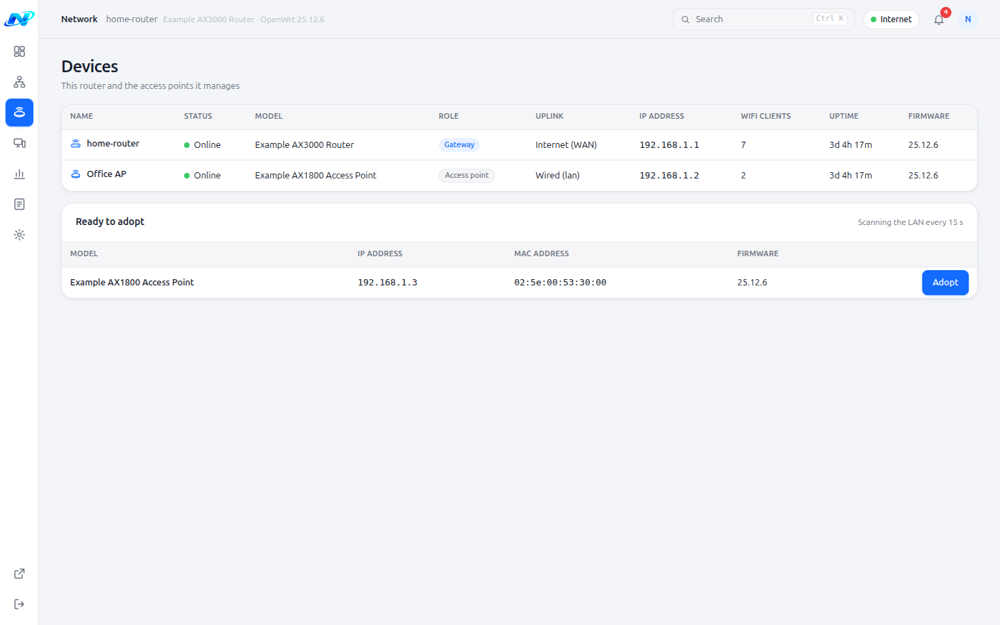
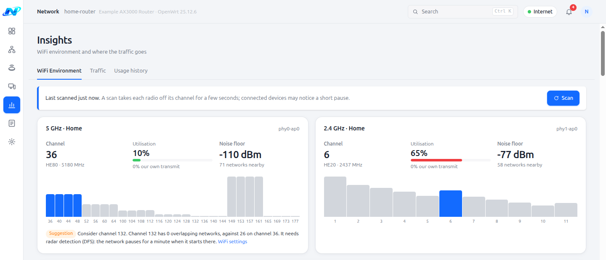
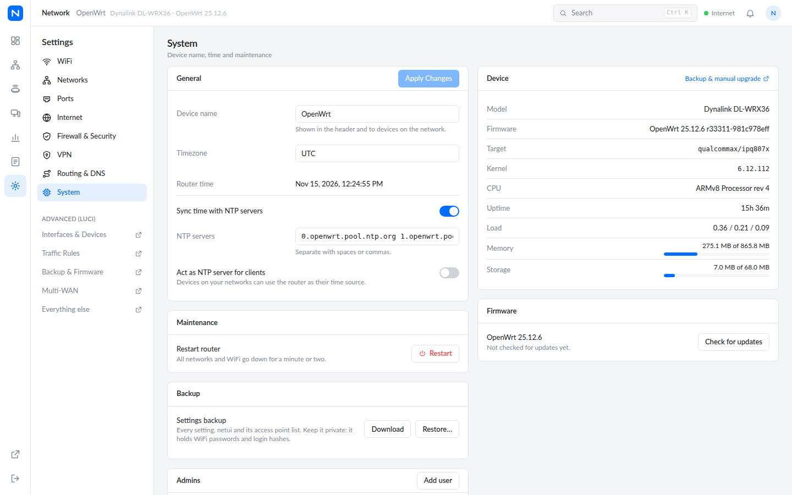

<p align="center">
  <picture>
    <source media="(prefers-color-scheme: dark)" srcset="docs/logo-dark.png">
    
  </picture>
</p>

# netui

A friendly web UI for OpenWrt: manage your router, WiFi, extra access points
and mesh from one place.

New to this? The **[user guide](docs/user-guide.md)** walks through
installing netui and setting up WiFi, a guest network, ad blocking, extra
access points and more, step by step.

## Screenshots

| | |
|---|---|
|  **Dashboard**: gateway health, internet throughput, the last speed test, ports, WiFi, top clients and recent events |  **Topology**: internet, gateway, ports, radios, access points and the clients on each |
|  **Devices**: the gateway and adopted access points with their uplink (cable or mesh) |  **WiFi**: SSIDs, radios with live utilisation and noise, wireless mesh, client steering |
|  **Client devices**: live activity, usage and open connections per client |  **Insights**: channel utilisation, nearby networks per channel and a channel suggestion |
|  **Usage history**: download and upload per device and per application, by month |  **Internet**: the WAN, a second connection for failover, speed tests |
|  **Ad blocking and content filtering** for every device on the network |  **System**: firmware updates, backup and restore, admins and read-only users |
|  **Every change is reviewed** and applied with a safety timer: if it cuts netui off, the router undoes it |  **On a phone**: the same UI with a bottom tab bar |

Captured on a Dynalink DL-WRX36 running OpenWrt 25.12.6, with a Xiaomi AX3600 as an adopted access point.

## Install on a router

netui runs on OpenWrt **24.10** and **25.x / snapshots**, on any router hardware
(the package contains no compiled code). LuCI stays installed and keeps working
alongside it. The examples use version `0.2.0` and the router at `192.168.1.1`;
substitute the latest version from [Releases](https://github.com/msjonker/netui/releases)
and your router's address.

### 1. Find out which package you need

Log in to the router over SSH and check the release:

```sh
ssh root@192.168.1.1
grep DISTRIB_RELEASE /etc/openwrt_release
```

| `DISTRIB_RELEASE` | Package manager | Download |
|---|---|---|
| `25.12.x` or `SNAPSHOT` | apk | `netui-0.2.0-r1.apk` |
| `24.10.x` | opkg | `netui_0.2.0-r1_all.ipk` |

Older releases (23.05 and before) are not supported.

### 2. Download the package and copy it to the router

Download the file from the [latest release](https://github.com/msjonker/netui/releases/latest)
on your computer, then copy it to the router's `/tmp` (on Windows, use PowerShell):

```sh
scp -O netui-0.2.0-r1.apk root@192.168.1.1:/tmp/        # OpenWrt 25.x / snapshots
scp -O netui_0.2.0-r1_all.ipk root@192.168.1.1:/tmp/    # OpenWrt 24.10
```

`-O` is needed because OpenWrt's SSH server (dropbear) does not support the newer
SFTP-based copy. If your router already has internet access you can instead
download on the router itself:

```sh
cd /tmp && wget https://github.com/msjonker/netui/releases/download/v0.2.0/netui-0.2.0-r1.apk
```

### 3. Install it

On the router, refresh the package lists (so dependencies such as `rpcd-mod-file`
can be installed) and install the file:

```sh
# OpenWrt 25.x / snapshots
apk update
apk add --allow-untrusted /tmp/netui-0.2.0-r1.apk

# OpenWrt 24.10
opkg update
opkg install /tmp/netui_0.2.0-r1_all.ipk
```

The router needs internet access for this step unless LuCI is already installed
(it then has every dependency). `--allow-untrusted` is required because the
release packages are not signed with an OpenWrt key.

### 4. Create the netui login

netui signs in with its own account, never root. Create it once:

```sh
netui-passwd
```

It asks for a password twice (at least 8 characters) and creates the user
`netui`, limited to what the UI needs. Run it again any time to change the password.

### 5. Open netui

Browse to **http://192.168.1.1/netui/** and sign in as `netui`. If LuCI is
installed with HTTPS (`luci-ssl`), use **https://192.168.1.1/netui/** instead:
the login session is a bearer token, so HTTPS is recommended.

On a freshly installed OpenWrt the Dashboard offers **Set Up**: WiFi on with a
name and password, the internet connection, time zone, and a password for the
router itself (`ssh`, LuCI), in one reviewed change.

### Adding access points

Any other OpenWrt router (24.10 or 25.x) can become an access point managed
from netui's **Devices** page. On that router:

1. Install `netui-agent` the same way as above (`netui-agent-0.2.0-r1.apk` or
   `netui-agent_0.2.0-r1_all.ipk` from the release).
2. Run `netui-agent prepare` and confirm. It turns the router into a plain
   access point: every port joins one LAN bridge, it gets its address from the
   gateway's DHCP, and its own DHCP server, IPv6 announcements and firewall go off.
3. Plug any of its ports into the gateway's LAN.

On the gateway, open **Devices**: the router appears under *Ready to adopt*.
Click **Adopt**, name it, and give its current root password (empty on a fresh
install). netui then gives it a dedicated login and a new random root password
(shown on its details page), and copies the gateway's WiFi networks to it.
From then on every WiFi change on the gateway is copied to all access points.

Each access point has its own details page under **Devices**: its uplink,
the WiFi clients on it (also shown on **Client Devices** and in **Topology**),
and its radios. Channel, width and transmit power can be set per access point,
so neighbouring access points do not have to share a channel; changes apply
with the same 30-second safety net as on the gateway.

#### Client steering

With `usteer` installed on the gateway and the access points, **Settings →
WiFi → Client steering** offers band steering (prefer 5 GHz), a roaming
assistant (devices with a weak signal are asked to move to a closer access
point; this also turns on BSS transition and 802.11k) and a minimum signal.
The gateway copies these settings to every access point.

#### Wireless mesh

Access points can also reach the gateway over WiFi (wireless mesh). Turn on **Settings → WiFi → Wireless mesh**: the gateway's 5 GHz
radio gets an encrypted 802.11s mesh link, and every adopted access point is
given the same one. An access point with a cable uses the cable and keeps the
mesh as a backup; unplug it and it switches to the mesh within about 20
seconds (spanning tree picks the path, so there is never a loop). The
Devices page shows each access point's uplink and mesh signal.

Mesh needs the full `wpad` on the gateway and every access point; the default
`wpad-basic-*` cannot do encrypted mesh. Replace it in one step, for example on
25.x: `apk add wpad-mbedtls '!wpad-basic-mbedtls'`. Adopt access points with a
cable first, then move them where you want them. Turning the mesh on fixes the
5 GHz channel (all mesh nodes must share it); avoid radar (DFS) channels
52-144, where a radar hit drops the mesh for about a minute.

`prepare` is a separate step on purpose: installing the package on your main
router by mistake changes nothing. WiFi networks on networks other than the LAN
are not copied yet (they need VLANs carried to the access point).

### Optional features

These features need an extra OpenWrt package (an add-on). Each one's card has
an **Install** button, and **Settings → System → Add-ons** lists them all with
Install and Remove; an access point's panel in **Devices** has the ones that
matter there (mesh, client steering, firmware updates). The router downloads
the package from its configured OpenWrt feeds, so it needs to be online, and
checks there is room first. `apk add …` or `opkg install …` over ssh works
too.

| Feature | Packages | Where |
|---|---|---|
| Smart Queues | `sqm-scripts` | Settings → Internet |
| UPnP / NAT-PMP | `luci-app-upnp` | Settings → Internet |
| Dynamic DNS | `luci-app-ddns` | Settings → Internet |
| Multi-WAN (failover, load balancing) | `mwan3` | Settings → Internet |
| Speed test | `librespeed-cli` (8 MB) or the much smaller `speedtestcpp` | Settings → Internet, Dashboard |
| WireGuard VPN server, VPN service (the router as a client) | `luci-proto-wireguard` | Settings → VPN |
| Tailscale (remote access without a public address) | `tailscale` (26 MB) | Settings → VPN |
| DNS over HTTPS | `https-dns-proxy` | Settings → Routing & DNS |
| Wake-on-LAN | `etherwake` | Client Devices → a device |
| WiFi schedules | `wifischedule` | Settings → WiFi |
| Ad blocking | `adblock-fast` | Settings → Firewall & Security |
| Guest portal | `opennds` | Settings → Networks |
| Usage history | `nlbwmon` | Insights → Usage history, client details |
| Firmware updates | `owut` (included in standard 25.x images) | Settings → System, Devices |

A few notes:

- **Multi-WAN** turns a spare LAN port into a second internet port (WAN2)
  and uses it for failover (WAN2 takes over when WAN1 stops answering) or
  load balancing. A custom mwan3 setup made in LuCI is left alone.
- **Ad blocking** blocks ads and trackers for every device through the
  router's DNS, from block lists you pick. Networks that use Content
  Filtering keep Cloudflare's filter instead.
- **Guest portal** shows devices on one network (a guest network, not the
  LAN) a sign-in page before they get internet, with an optional session
  length and speed limit, and lists who is signed in. openNDS's
  "dnsmasq-full" warning only matters for its walled garden, which netui does
  not use.
- **Installing never switches anything on.** The guest portal and DNS over
  HTTPS are installed switched off (both would otherwise change the network
  at once); turn them on in netui. Mesh replaces the basic WiFi package with
  the full one, which restarts WiFi once, and cannot be removed from netui.
  Removing an add-on keeps its settings.
- **WireGuard**: after installing it for the first time, restart the router
  (or the network) once; until then new WireGuard interfaces stay down.
- **VPN service** sends all devices, or chosen ones, through a VPN provider
  from its WireGuard configuration file, with an optional kill switch that
  blocks their internet while the tunnel is down.
- **Tailscale** reaches home even behind carrier-grade NAT, with no port
  open: sign in with a Tailscale account, then optionally share the home
  networks and offer the router as an exit node (approve both in the
  Tailscale admin console).
- **DNS over HTTPS**: netui switches https-dns-proxy on and off and picks the provider. LAN devices that use
  their own DNS server are redirected to the router while it is on.
- **Usage history** keeps monthly usage per device and per application. By
  default nlbwmon keeps it in memory; the switch on the Usage history page
  moves it to flash so it survives a restart.

### Backup and restore

**Settings → System → Backup** downloads all settings (and netui with its
access point list) as one file, and restores such a file: netui shows what
it contains before anything is sent, and follows the router if the backup
moves it to another address. A backup holds WiFi passwords and login hashes;
keep it private.

### Users and roles

**Settings → System → Admins** adds people who can sign in to netui: an
**Admin** changes settings; **Read only** sees everything netui shows but
changes nothing and cannot download a backup. Each user is a login on the
router, like the one `netui-passwd` creates.

### Updating

Download the new package and run the same install command as in step 3. Your
settings and the `netui` login are kept.

### Firmware updates

**Settings → System → Firmware** checks for a newer OpenWrt and upgrades the
router with `owut` (attended sysupgrade). The OpenWrt build server makes an
image with the packages you have installed, and the router installs it and
restarts with its settings. Access points upgrade the same way from their
panel on the Devices page. The device needs internet access.

No internet on the router, or a particular version? **Install it by hand**
under the same card takes a *sysupgrade* file from
[firmware-selector.openwrt.org](https://firmware-selector.openwrt.org/),
checks it is made for this router, shows its SHA-256 and installs it keeping
the settings. Packages installed with `apk`/`opkg` are not in that image and
need installing again afterwards.

netui is not in the OpenWrt package feeds, so the new image is built without
it. Its files are kept across the upgrade like settings are, so netui and the
access point agent keep working. Afterwards `apk`/`opkg` no longer lists the
package; installing it again (see Updating) puts it back on the list.

### Uninstalling

```sh
apk del netui        # OpenWrt 25.x / snapshots
opkg remove netui    # OpenWrt 24.10
```

This removes the UI and its permissions file but keeps the `netui` login. To
delete that as well: `uci delete rpcd.netui && uci commit rpcd && /etc/init.d/rpcd restart`.

### Troubleshooting

- **Cannot sign in right after installing:** restart rpcd so it loads the new
  permissions: `/etc/init.d/rpcd restart`.
- **`UNTRUSTED signature`** from apk: add `--allow-untrusted` (step 3).
- **`unable to select packages` / dependency errors:** run `apk update` or
  `opkg update` first; the router needs internet access to fetch dependencies.
- **404 at `/netui/`:** check the files are there with `ls /www/netui`.

## Release

Push a tag: `git tag v0.2.0 && git push origin v0.2.0`. The Release workflow
tests and builds the UI, packages it with the official OpenWrt SDK images
(`.apk` from 25.12, `.ipk` from 24.10) and publishes both. Locally:
`npm run build && npm run package x86-64-openwrt-25.12 0.2.0` (needs Docker).

## Develop

```sh
npm install
cp .env.example .env.local   # set ROUTER_URL
npm run dev                  # /ubus is proxied to ROUTER_URL
npm test
npm run build                # typecheck + build; check:budget holds the initial load to 190 KB gzipped
```

## Dev router (Docker)

A disposable OpenWrt 25.12 container with the real rpcd, uhttpd, netifd, dnsmasq
and LuCI, plus two DHCP clients on its LAN. It serves `dist/` at `/netui/` and
mounts the ACL from this repo, so you can exercise the real login and ACL.

```sh
npm run router:up              # LuCI at http://10.231.1.2/, netui at http://10.231.1.2/netui/
echo ROUTER_URL=http://10.231.1.2 > .env.local
npm run record-fixtures:dev    # -> test/fixtures/ubus/dev-container/
npm run router:reset           # throw it away and start clean
```

Login `netui` / `netui`. `OPENWRT_TAG=x86-64-24.10.8 npm run router:reset` to try 24.10.

Simulated WiFi: run `sudo modprobe mac80211_hwsim radios=3` on the host, then
`npm run router:wifi`. Two radios go to the router and one to a station client
(`netui-client-tablet`). Only hwsim phys are moved; real WiFi hardware is never
touched. Radios return to the host when the containers stop, so re-run after
`router:up`. Undo with `sudo rmmod mac80211_hwsim`.

The client containers route through Docker's bridge (10.231.1.1), not through
the router, so their traffic does not show on the dashboard chart. Generate WAN
traffic from the router itself (`npm run router:shell`, then `ping 10.231.0.1`).

Limits: without hwsim there are no radios (iwinfo and `wireless` are empty), `system info`
reports the host kernel's memory and uptime, and ujail is shimmed out because
Docker denies its namespaces. It is not the target device and not a substitute
for the x86 VM when testing apply/rollback on network or firewall changes.

## Test VMs (ports, VLANs, firewall input)

Destructive changes (bridge membership, VLANs, the LAN address, firewall input)
are tested on OpenWrt x86 VMs under libvirt, never on a real router. Needs
membership of the `libvirt` group; no sudo.

```sh
dev/vm/vm.sh up          # router 10.232.1.1 (eth0 LAN, eth1 WAN, eth2-eth4 ports) + client VM on eth2
dev/vm/vm.sh deploy      # copy dist/ and the ACL; netui at http://10.232.1.1/netui/ (netui / netui)
dev/vm/vm.sh ssh 'bridge vlan show'
dev/vm/vm.sh client      # shell on the client, cabled to router eth2
dev/vm/vm.sh down
NETUI_VM=vlan scripts/record-fixtures.sh   # -> test/fixtures/ubus/vm/vlan/
```

To check a tagged VLAN end to end from the client:
`ip link add link eth0 name eth0.20 type vlan id 20 && ip link set eth0.20 up && udhcpc -i eth0.20`.

The recorded `vm/plain` and `vm/vlan` scenarios back the switch model tests and
`resetRouter({}, 'plain' | 'vlan')` in component tests.

## Testing

- Unit tests type against recorded fixtures in `test/fixtures/ubus/`. Record new
  ones with `npm run record-fixtures` (or `:dev`) before writing an API wrapper.
- Component tests mock `src/api/ubus.ts` with `test/fakeRouter.ts`, an in-memory
  router that serves the fixtures and stages uci writes with rpcd's recorded
  semantics (`uci changes` format, status 5/6 on confirm/apply, rollback
  restoring the staged changes). Assert on `router.writes()`.
- `test/applyFlow.ts` drives the review dialog (`review()`, `applyReviewed()`).
- `test/dom.ts`: use `type()` for inputs and `pick()` for `<select>`.
  `@testing-library/preact` turns `fireEvent.change` into an `input` event, so a
  select's `onChange` never fires with it; `pick()` dispatches a real `change`.
- Drawers are `<aside>` (role `complementary`); modals are `<dialog>`.

## Install as a package

`openwrt/Makefile` packages the prebuilt `dist/` plus the ACL and a
`netui-passwd` helper. Use the SDK for the target release (25.x builds an
`.apk`, 24.10 an `.ipk`):

```sh
npm run build
ln -s "$PWD/openwrt" <sdk>/package/netui
make -C <sdk> package/netui/compile V=s     # -> <sdk>/bin/packages/*/base/netui-*.apk
```

Or in Docker, without installing an SDK:

```sh
docker run --rm -v "$PWD:/src" openwrt/sdk:x86-64-25.12.5 sh -c \
  'ln -s /src/openwrt package/netui && make defconfig && make package/netui/compile V=s && cp bin/packages/*/base/netui-*.apk /src/'
```

The SDK warns that `rpcd`, `uhttpd` etc. "do not exist" when no feeds are
installed; that is harmless, the dependencies are still recorded in the package.

On the router: `apk add --allow-untrusted netui-*.apk` (or `opkg install` on
24.10), then `netui-passwd` to create the login, and open `/netui/`.

## Manual setup (without the package)


1. Install the ACL and the rpcd plugins: copy `openwrt/files/usr/share/rpcd/`
   (`acl.d/netui.json` and the `ucode/netui-*` plugins) to `/usr/share/rpcd/`
   on the router. The plugins need `rpcd-mod-ucode` and `uclient-fetch`.
2. Create the dedicated rpcd login (never use root):

   ```sh
   uci add rpcd login
   uci set rpcd.@login[-1].username='netui'
   uci set rpcd.@login[-1].password="$(uhttpd -m 'choose-a-password')"
   uci add_list rpcd.@login[-1].read='netui'
   uci add_list rpcd.@login[-1].write='netui'
   uci commit rpcd
   /etc/init.d/rpcd restart
   ```

3. Deploy: `ssh root@$ROUTER_HOST mkdir -p /www/netui && ROUTER_HOST=... npm run deploy`,
   then open `http(s)://<router>/netui/`.

Serve over HTTPS where possible; the session id is a bearer token.

## License and trademarks

netui is released under the MIT license (see [LICENSE](LICENSE)).

netui is an independent open-source project. It is not affiliated with,
endorsed by or sponsored by any router or network equipment maker. OpenWrt
and all other product names are trademarks of their respective owners and
are used only to describe compatibility.
