# netui user guide

This guide walks you through setting up your network with netui, step by
step. You do not need to be a networking expert: each section says what a
setting is for before it says where to click. Technical words are explained in
the [glossary](#glossary) at the end.

netui runs on your router, a box running OpenWrt. It does not replace
OpenWrt's own settings pages (called **LuCI**); those stay available for
anything netui does not cover.

**Contents**

1. [Before you start](#1-before-you-start)
2. [Install netui](#2-install-netui)
3. [Sign in and find your way around](#3-sign-in-and-find-your-way-around)
4. [How changes work (and why you cannot lock yourself out)](#4-how-changes-work)
5. [Your internet connection](#5-your-internet-connection)
6. [WiFi](#6-wifi)
7. [A guest network](#7-a-guest-network)
8. [Your devices](#8-your-devices)
9. [Safety: ad blocking, filtering and the firewall](#9-safety-ad-blocking-filtering-and-the-firewall)
10. [More WiFi coverage: access points and mesh](#10-more-wifi-coverage-access-points-and-mesh)
11. [Reaching home from away (VPN)](#11-reaching-home-from-away-vpn)
12. [Keeping an eye on things](#12-keeping-an-eye-on-things)
13. [Updates and backups](#13-updates-and-backups)
14. [Other people who manage the network](#14-other-people-who-manage-the-network)
15. [On your phone](#15-on-your-phone)
16. [When something goes wrong](#16-when-something-goes-wrong)
17. [Glossary](#glossary)

---

## 1. Before you start

You need:

- **A router running OpenWrt 25.12 or 24.10.** If yours is new from the
  shop it probably runs the maker's own software; installing OpenWrt on it is
  a separate job (see [openwrt.org](https://openwrt.org/toh/start) for your
  model).
- **A computer** connected to the router, by cable or WiFi.
- **About 15 minutes** for the installation.

The router's address in this guide is `192.168.1.1`, OpenWrt's default. If
yours is different, use your own wherever you see it.

> **Tip.** Connect your computer with a network cable for the installation.
> Some settings briefly restart the WiFi, and a cable keeps you connected.

## 2. Install netui

Installing means copying one file to the router and running two commands on
it. You type the commands in a **terminal**:

- **Windows:** open *PowerShell* (search for it in the Start menu).
- **macOS:** open *Terminal* (in Applications → Utilities).
- **Linux:** open your terminal app.

The commands below use `ssh` (to run a command on the router) and `scp` (to
copy a file to it). Both come with Windows 10 and later, macOS and Linux.

1. **Find out which file you need.** In the terminal, type:

   ```sh
   ssh root@192.168.1.1 cat /etc/openwrt_release
   ```

   The first time, it asks whether you trust the router: type `yes`. Then it
   asks for the router's root password (the one you set when installing
   OpenWrt; if you never set one, it just lets you in). Look at the line that
   starts with `DISTRIB_RELEASE`:

   | It says | Download this file |
   |---|---|
   | `25.12…` or `SNAPSHOT` | `netui-0.4.0-r1.apk` |
   | `24.10…` | `netui_0.4.0-r1_all.ipk` |

2. **Download the file** from the
   [releases page](https://github.com/msjonker/netui/releases/latest) into your
   Downloads folder.

3. **Copy it to the router.** In the terminal, go to your Downloads folder
   (`cd Downloads`) and type the line for your file:

   ```sh
   scp -O netui-0.4.0-r1.apk root@192.168.1.1:/tmp/       # 25.12 or SNAPSHOT
   scp -O netui_0.4.0-r1_all.ipk root@192.168.1.1:/tmp/   # 24.10
   ```

4. **Install it.** Sign in to the router and install:

   ```sh
   ssh root@192.168.1.1
   apk add --allow-untrusted /tmp/netui-0.4.0-r1.apk      # 25.12 or SNAPSHOT
   opkg install /tmp/netui_0.4.0-r1_all.ipk               # 24.10
   ```

   If it reports missing packages, the router needs internet access to fetch
   them: connect it to your modem first.

5. **Choose a password for netui.** Still signed in to the router, type:

   ```sh
   netui-passwd
   ```

   Type a password (at least 8 characters) twice. Nothing appears on the
   screen while you type; that is normal. This creates the user **netui**.
   It is separate from the router's root password on purpose: netui can only
   do what netui needs.

6. Type `exit` to leave the router.

## 3. Sign in and find your way around

Open a browser and go to **http://192.168.1.1/netui/**. Sign in as `netui`
with the password you just chose.

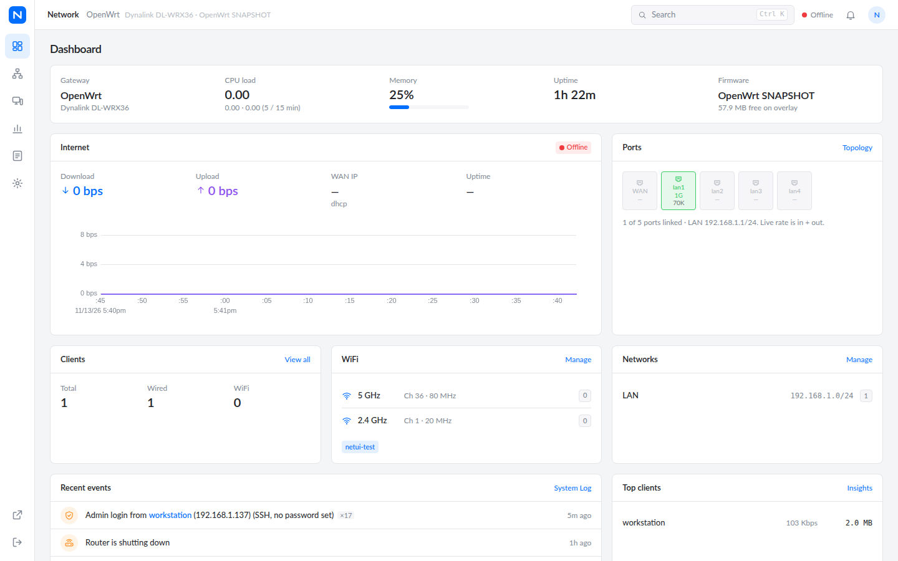

The bar on the left (along the bottom on a phone) has the main sections:

| Section | What it shows |
|---|---|
| **Dashboard** | Is the internet up, how busy is the connection, how is the router doing, what happened recently. |
| **Topology** | A map: internet, router, access points, and which device is connected where. |
| **Devices** | Your router and any extra access points. |
| **Client Devices** | Every phone, laptop, TV and gadget on your network. |
| **Insights** | WiFi channels and neighbouring networks, traffic, and usage history. |
| **System Log** | What happened on the router, in plain events. |
| **Settings** | Everything you can change, in tabs: WiFi, Networks, Ports, Internet, Firewall & Security, VPN, Routing & DNS, System, Diagnostics. |

**A brand-new router?** The Dashboard then says *Your router is not set up
yet* and offers **Set Up**: a few short steps to turn the WiFi on with a name
and password, check the internet connection, pick your time zone, and give
the router itself a password (for `ssh` and LuCI; netui keeps its own
sign-in). You see every change before it is made, and the last step shows a
QR code that phones can scan to join the new WiFi.

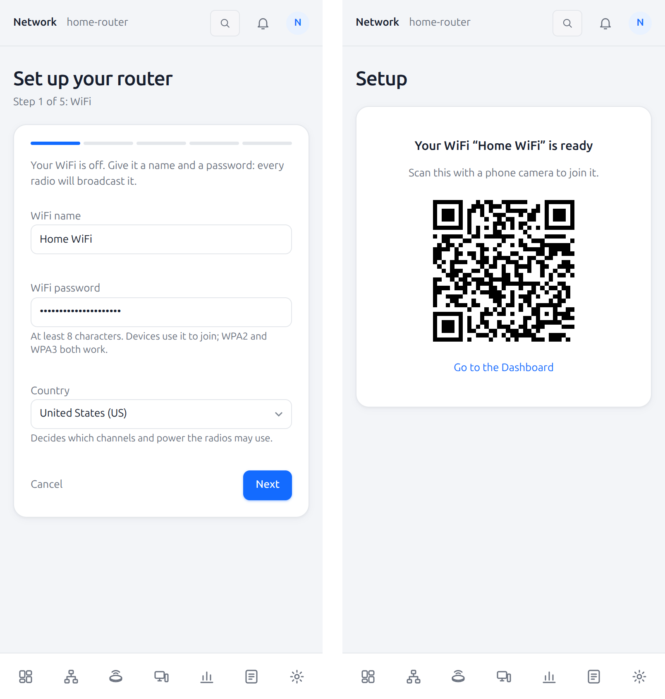

The first step is the WiFi name and password; the last shows the QR code.

Your initial in the top right corner opens a small menu: who you are signed in
as, the **theme** (*System* follows your computer's light or dark setting, or
pick *Light* or *Dark*; the choice is remembered in this browser), a link to
LuCI, and **Sign out**. The magnifying glass searches devices,
networks and settings (or press `Ctrl K`).

## 4. How changes work

Every setting that changes how your network works goes through the same
three steps, so a mistake can never cut you off for good:

1. You change something and click **Apply Changes**.
2. netui shows **Review changes**: exactly what will change. Check it and
   click **Apply Changes** again (or **Discard**).
3. The router makes the change with a **30-second safety timer**. netui then
   checks that it can still reach the router and confirms. If it cannot (say
   the change cut your computer off), nothing is confirmed and the router
   puts everything back the way it was after 30 seconds.

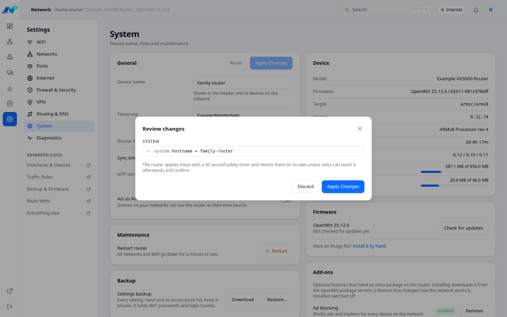

If the router undid a change, netui tells you. Look at what you changed, and
try again more carefully, or ask for help.

## 5. Your internet connection

**Settings → Internet** shows your connection to the internet (the **WAN**).

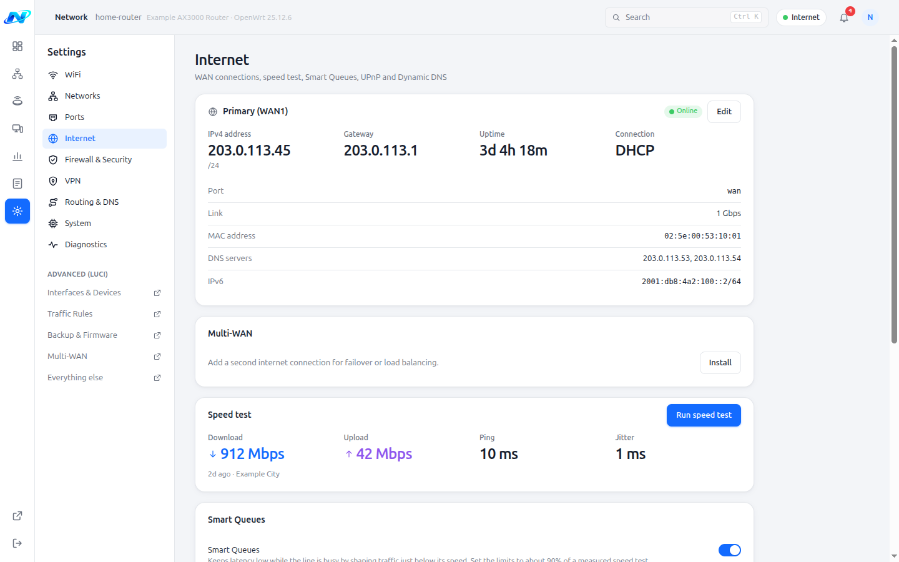

- **Most connections need no setup.** If your router is plugged into a modem
  or into your internet provider's box, the connection type is usually
  *DHCP* and it just works.
- **Fibre or DSL with a username and password** (often called *PPPoE*):
  click **Edit** on **Primary (WAN1)**, choose PPPoE and enter the username
  and password your provider gave you.
- **"Behind carrier-grade NAT" or "behind another router".** netui warns
  you when your router has no address of its own on the internet: your
  provider shares one between several customers, or there is another router
  in front of yours. Your internet works, but nothing at home can be reached
  from outside: port forwards and the VPN server will not work. Ask your
  provider for a public IPv4 address, put the other router in bridge mode, or
  use Tailscale or Cloudflare Tunnel ([section 11](#11-reaching-home-from-away-vpn)),
  which work without one.
- **Speed test.** Click **Run speed test** to measure your internet speed from
  the router itself, without WiFi getting in the way. It takes about 30
  seconds. (An add-on.)
- **Smart Queues** keep video calls and games smooth while someone downloads
  something big. Enter your connection's real speeds (run a speed test first)
  and turn it on. (An add-on.)
- **A second internet connection (Multi-WAN).** If you have a second
  connection (say a 4G/5G router as a backup), plug it into a free port on
  your router and click **Add WAN2** under **Multi-WAN**. Choose:
  - **Failover**: everything uses your main connection; the second takes
    over only when the main one stops working, and hands back when it
    recovers.
  - **Load balance**: both connections are used at once.

  (An add-on.)

**Add-ons.** Some features need an extra piece of software on the router.
Where one is missing, its card says what the feature does and shows an
**Install** button: click it, check the size, and click **Install** again.
The router downloads it (it needs to be online) and the feature appears when
it is done, usually within a minute. **Settings → System → Add-ons** lists
every add-on, installed or not, and can remove one again; its settings stay
on the router. Nothing switches on by itself just because it was installed.

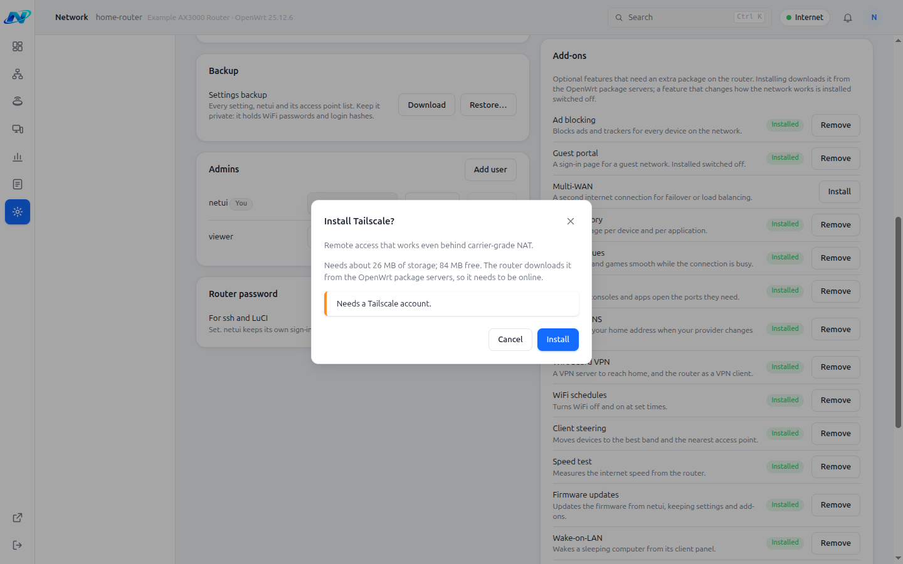

## 6. WiFi

**Settings → WiFi** lists your WiFi networks and the radios that send them.

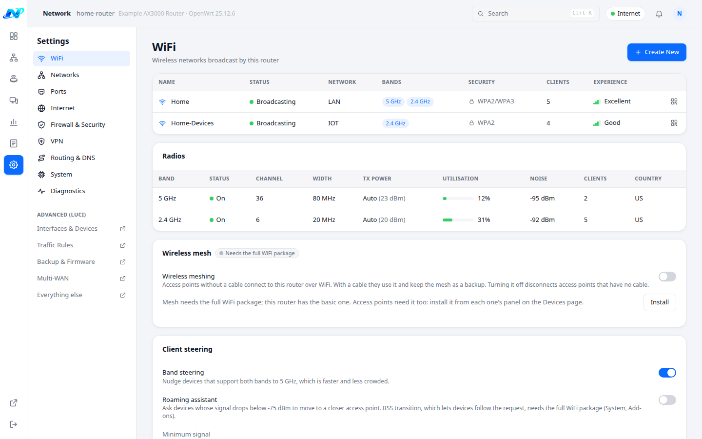

**Change the WiFi name or password:** click the WiFi network, change
**Name (SSID)** or **Password**, and apply. Devices that were connected have
to join again with the new password.

**Create a WiFi network:** click **Create New**, give it a name and a
password, and choose which network its devices join (normally *LAN*).

**Good choices for most homes:**

- **Security:** WPA2/WPA3, so both old and new devices can connect.
- **One name for both bands.** Use the same name and password on 2.4 GHz and
  5 GHz; devices pick the better one by themselves.
- **Share WiFi:** the share button next to a network shows a QR code. Point
  a phone's camera at it to join without typing the password.

**More passwords for one WiFi:** open a WiFi network and use **More
passwords → Add Password**. Give each person or group of devices a password of
its own, for example "Kids" or "Smart plugs". netui fills in a random password
you can change. Removing a password disconnects only the devices that joined
with it, and everyone else keeps theirs. The share button next to a saved
password shows a QR code for that password.

- A password can also choose the **network** its devices get, for example the
  IoT network: smart plugs join the same WiFi name as everyone else but end up
  kept apart. This depends on the WiFi hardware. Some radios cannot do it, and
  netui then offers only the WiFi's own network. On access points that cannot
  do it, such a password is left out, so its devices cannot join there (they
  are not let onto the main network instead). The access point's panel lists
  the passwords it left out.
- More passwords need **WPA2** security. WPA3 can check only one password per
  WiFi.

**Radios** (further down) set the channel and power of each radio. *Auto*
works well; if your WiFi is slow, **Insights → WiFi Environment** suggests a
less crowded channel.

**WiFi schedule** turns WiFi off at night, for example. (An
add-on.)

**Client steering** (needs `usteer`) moves devices to the best band and the
nearest access point.

## 7. A guest network

Visitors should be able to use your internet without seeing your computers,
printers and cameras. That takes two steps, and an optional third.

1. **Create the network.** **Settings → Networks → Create New Network.** Name
   it `guest` and set **Access** to **Isolated**: devices on it can reach the
   internet, but not your own network or each other. Apply.
2. **Give it WiFi.** **Settings → WiFi → Create New.** Name it, for example,
   "Smith Guests", give it a password, turn on **Guest network** and choose the
   `guest` network. Apply.
3. **Optional: a sign-in page.** Like hotel WiFi, guests then see a page
   before they get internet. **Settings → Networks → Guest portal:** turn on
   **Show guests a sign-in page**, choose the `guest` network, give the page a
   name, and choose how long a sign-in lasts and how fast each guest may go.
   The **Guests** list shows who is signed in; you can let someone in or sign
   them out. (An add-on.)

> **Do not put a sign-in page on your main (LAN) network.** Everyone,
> including you, would have to sign in.

## 8. Your devices

**Client Devices** lists everything that is or was connected.

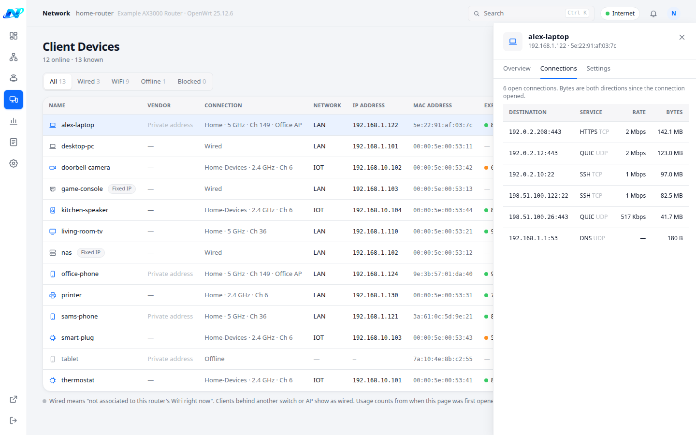

Click a device to:

- **Give it a name** (*Alias*), so "android-5f2c…" becomes "Emma's phone".
- **Give it a fixed address** (*Fixed IP address*), which a printer, a game
  console or anything you forward ports to needs.
- **See what it is doing:** current speed, data used this session (and this
  month, with usage history turned on), and its open connections.
- **Reconnect** it (WiFi devices), which helps when it is stuck.
- **Wake** it: switch on a sleeping or powered-off computer that supports
  *Wake-on-LAN*, usually over a cable. (An add-on.)
- **Block** it: it can no longer reach the internet or your network until you
  unblock it (under **Firewall & Security → Blocked Devices**).

## 9. Safety: ad blocking, filtering and the firewall

**Settings → Firewall & Security.**

**Ad blocking** (tab *Ad Blocking & Filtering*) blocks ads, trackers and
known bad sites for every device in the house, including smart TVs and
phones, without installing anything on them. Turn on **Block ads and
trackers**, keep the suggested list, and apply; the lists download in about a
minute. If a website stops working, put its name under **Never block**.
(An add-on.)

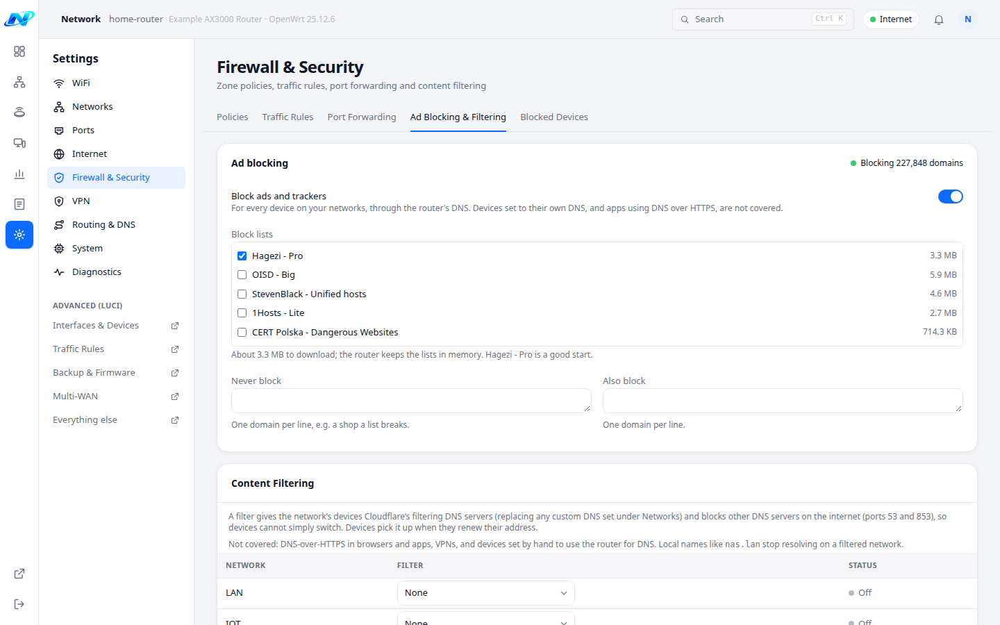

**Content filtering** (same tab) is for families: per network, choose
**Malware blocking**, or **Family** to also block adult sites. It uses
Cloudflare's free filtering service.

**Port Forwarding** lets something on the internet reach a device at home,
for example a game console or a home server. Only add what a device's manual
asks for, and give that device a fixed address first (see
[Your devices](#8-your-devices)).

**DMZ** (on the same tab) sends everything that comes in from the internet,
and that no port forward or router service already uses, to one device. Some
game consoles want this. That device is then fully exposed to the internet:
use it only for something that needs it, and give it a fixed address first.

**DNS over HTTPS** (**Settings → Routing & DNS → DNS**) encrypts the router's
name lookups ("where is example.com?"), so your internet provider can no
longer see or change them. Turn on **Encrypt DNS** and pick a provider; some
also block malware or adult sites. (An add-on.)

**Policies** and **Traffic Rules** decide which networks may talk to which.
The defaults are safe: leave them unless you know why you want a change.

## 10. More WiFi coverage: access points and mesh

If WiFi does not reach every room, add another OpenWrt router as an **access
point** (an extra WiFi transmitter for the same network). netui manages it
from your main router, so you set everything up in one place.

1. **Prepare the second router.** Install the `netui-agent` file on it the
   same way you installed netui ([step 2](#2-install-netui)), then sign in to
   it and run `netui-agent prepare`. This changes nothing yet; it only makes
   the router ready to be adopted.
2. **Plug it in.** Connect any of its ports to a LAN port of your main router
   with a cable.
3. **Adopt it.** Open **Devices** in netui. After a few seconds it appears
   under **Ready to adopt**. Click **Adopt**, give it a name ("Upstairs"), and
   enter its current root password. It restarts its network and then
   broadcasts your WiFi networks.

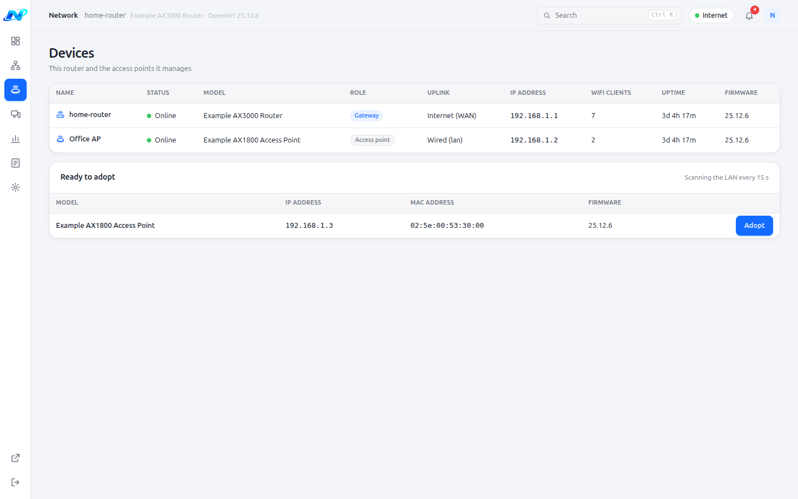

From then on, every WiFi change you make on the main router is copied to the
access point. Click it in **Devices** to open its panel: how it is connected,
the devices on its WiFi, its radios, firmware updates and add-ons. Under
**Radios**, **Edit** sets the channel, width and power for that access point
alone, so two access points near each other do not have to share a channel.

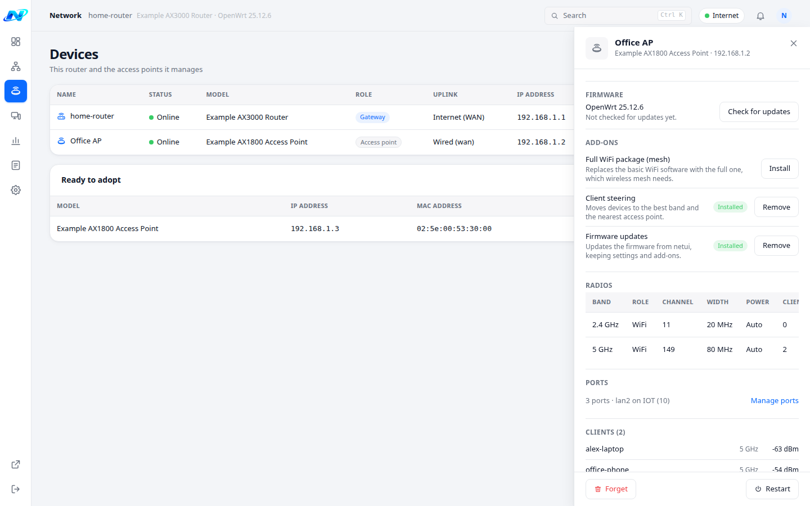

**Your other networks on access points.** Networks you create under
**Settings → Networks** (an IoT network, a guest network) reach every access
point too, over its cable or the mesh. Their WiFi is copied like the main
WiFi, so a smart plug can join the IoT WiFi upstairs. **Settings → Ports**
has a row of devices: pick the access point to see its ports, and click a
port to put it on another network. For example, plug a camera into an access
point's port and put that port on the IoT network. The port that leads to the
main router is marked **To this router** and always carries every network.
Changes are reviewed and applied like any other: if one cuts the access point
off, it undoes the change by itself after 30 seconds.

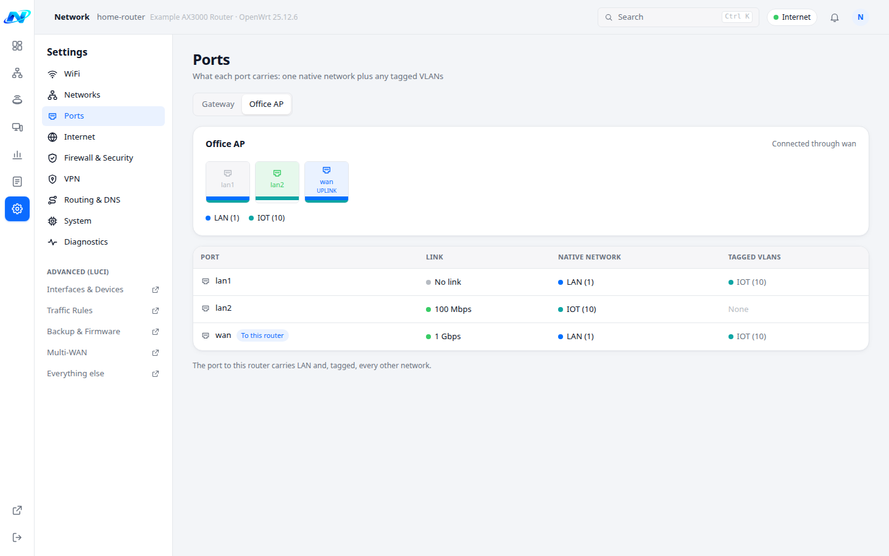

The first time netui carries these networks to an access point, the access
point restarts its network for a few seconds and may get a new address from
the main router.

**Wireless mesh.** Once adopted with a cable, an access point can also
connect to the main router over WiFi. Turn on **Settings → WiFi → Wireless
mesh**. Then you can move the access point somewhere without a cable: it
finds the main router through the air. With the cable plugged in it uses the
cable, and falls back to the mesh if the cable is pulled. Mesh needs the full
version of the WiFi software on every router: the mesh card offers to install
it on the main router, and each access point's panel in **Devices** has it
under **Add-ons**. WiFi restarts once while it installs.

**Where to place it:** halfway between the main router and the area with poor
WiFi, not in the dead zone itself. In **Devices**, the access point's signal
to the main router should be better than about −70 dBm.

## 11. Reaching home from away (VPN)

A **VPN** lets your phone or laptop use your home network from anywhere: to
reach a home server, or to browse safely on hotel WiFi.

1. **Settings → VPN → Create VPN Server.** The defaults are fine. If your
   internet provider changes your address now and then, set up **Dynamic DNS**
   first (**Settings → Internet**) and use that name as the **Endpoint**.
2. Add a client for each phone or laptop. netui shows a QR code: scan it in
   the **WireGuard** app on the phone. For a laptop, download the
   configuration file and import it in the WireGuard app.

(An add-on: **WireGuard VPN**. Restart the router once after installing it.)

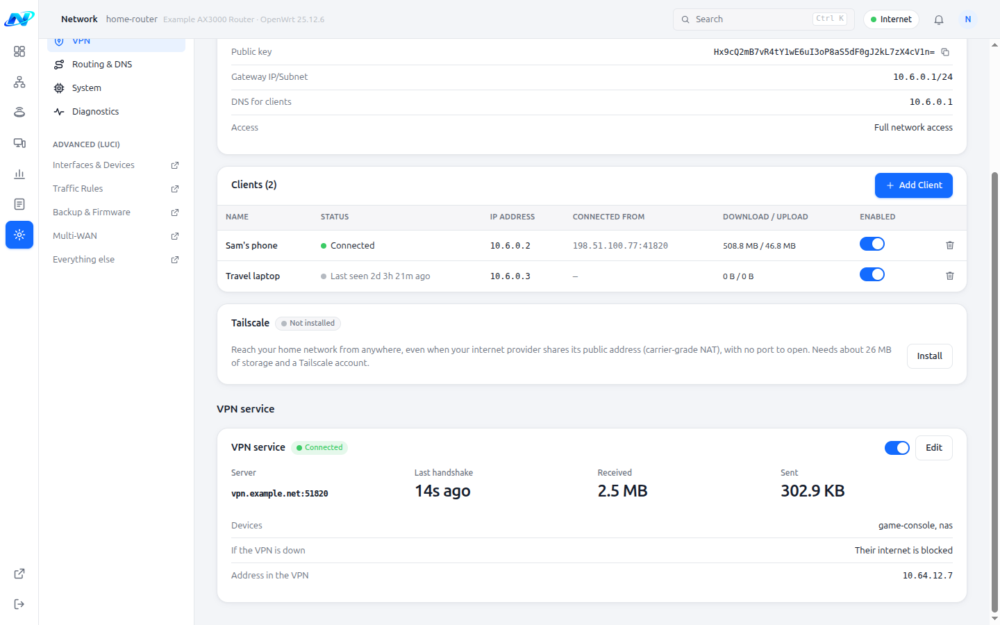

**Tailscale** is the easier way in when the VPN server cannot work: if your
provider uses carrier-grade NAT (netui warns you), or you cannot or do not
want to open a port. Install the Tailscale add-on on its card (about 26 MB), then
**Settings → VPN → Tailscale → Connect** and sign in with a Tailscale
account (free for personal use). Install the Tailscale app on your phone and
laptop with the same account. With **Share my home network** on, they reach
every device at home, not just the router; with **Use this router as an exit
node** on, they can send all their internet traffic through home, say on
public WiFi. Approve both for this router in the Tailscale admin console.

**Cloudflare Tunnel** publishes a website or app at home (a home server, a
camera's page, a photo library) under your own domain, without a public
address or an open port. You need a Cloudflare account with your domain on it.
Install the Cloudflare Tunnel add-on on its card (about 25 MB). In the
Cloudflare dashboard, open **Networks → Tunnels**, create a tunnel, choose its
connector, and copy the install command it shows. Paste it into the card on
**Settings → VPN** and click **Connect**: netui keeps only the token, and the
card turns *Connected* within a few seconds. Then, on the tunnel's page in the
dashboard, add a public hostname for each website or app with the device's
address at home, for example `http://192.168.1.20:8080`. Anyone on the
internet can open a published hostname, so protect anything private (this
router's pages included) with an Access policy there. **Turn Off** stops the
tunnel and keeps the token; **Remove** forgets it (the tunnel itself stays in
your account).

**Using a VPN service** (the other way round): **Settings → VPN → VPN service
→ Set Up** sends your home's internet traffic through a VPN provider, for
privacy or to appear in another country. Download a **WireGuard**
configuration file from your provider (choose a server location there) and
load it. Choose **All devices** or only **Chosen devices** (give them fixed
addresses first), and turn on **Block the internet if the VPN is down** if
nothing should ever go out without it. After installing WireGuard for the
first time, restart the router once.

## 12. Keeping an eye on things

- **Dashboard:** internet status and speed, the router's health, the last
  speed test and recent events.
- **Topology:** who is connected where, at a glance.
- **Insights → WiFi Environment:** how busy each WiFi channel is and which
  neighbouring networks use it. Use **Scan** and follow the suggestion if
  your channel is crowded.
- **Insights → Traffic:** what is using your connection right now.
- **Insights → Usage history:** how much each device and each application
  used this month and in earlier months. Turn on **Keep history across
  restarts** so a restart does not erase it. (An add-on.)

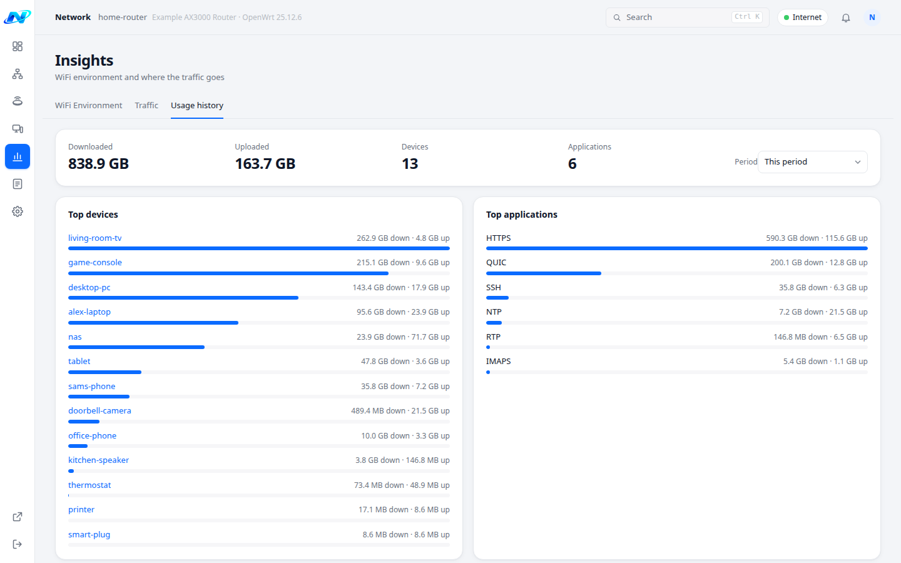

- **System Log:** a readable list of events (devices joining, the internet
  going down and up, changes made).

## 13. Updates and backups

**Firmware updates.** **Settings → System → Firmware → Check for updates.**
If there is one, click **Update**: the router has an image built with your
add-ons, installs it and restarts. Allow about five minutes; your settings and
netui are kept. Access points update the same way from their panel in
**Devices**. (Standard OpenWrt 25.12 includes this; otherwise it is an add-on.)

**Installing a firmware file yourself.** If the router has no internet, or
you need a particular version, download the *sysupgrade* file for your model
from [firmware-selector.openwrt.org](https://firmware-selector.openwrt.org/)
and use **Settings → System → Firmware → Install it by hand**. netui checks
that the file is made for your router and shows its checksum (compare it with
the one on the download page) before anything is installed. Settings are
kept.

**Router password.** **Settings → System → Router password** sets the
password for `ssh` and LuCI. A new router has none, so anyone on your network
could sign in to it: set one.

**Updating netui itself.** Download the new file and install it as in
[step 2](#2-install-netui). Your settings stay.

**Backups.** **Settings → System → Backup → Download** saves every setting in
one file. Do this before big changes, and keep the file somewhere safe: it
contains your WiFi passwords. **Restore…** puts a backup back; the router
restarts with those settings.

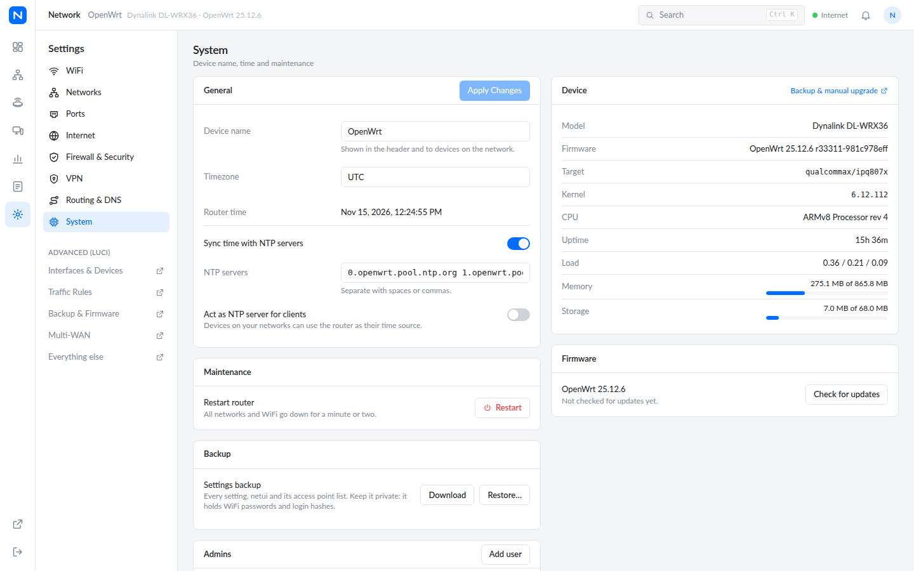

## 14. Other people who manage the network

**Settings → System → Admins → Add user.**

- **Admin** can change everything.
- **Read only** can look at everything (devices, usage, settings) but change
  nothing, and cannot download backups. Good for a family member who wants to
  see what is going on, or for helping someone remotely without risk.

Each person signs in with their own name and password. You cannot remove
yourself, and there is always at least one admin.

## 15. On your phone

netui works in a phone's browser: open the same address while connected to
your WiFi. The sections move to a bar along the bottom.

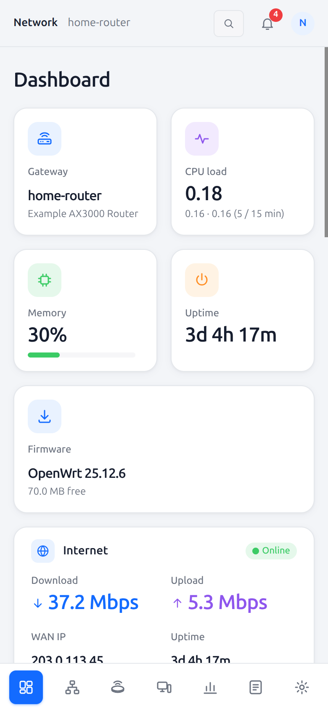

## 16. When something goes wrong

**I cannot open netui.**
- Make sure your computer is connected to the router (WiFi or cable) and try
  **http://192.168.1.1/netui/** again.
- If you changed the router's address under **Networks**, use the new one.

**netui says the router undid my change.** That is the safety timer at work
(see [How changes work](#4-how-changes-work)): the change cut off netui's
connection to the router. Your network is as it was before.

**I forgot the netui password.** Sign in to the router with `ssh
root@192.168.1.1` and run `netui-passwd` again to set a new one.

**The internet is down.** The **Dashboard** says whether the router itself
is online. If it is not, open **Settings → Diagnostics → Run Check**: it
tests the cable, the address from your provider, the internet and name
lookup in turn, and says what to do about the first one that fails. Restart
your modem, check the cable between modem and router, then look at
**Settings → Internet**. **Diagnostics** can also *ping*, *trace the route
to* or *look up* any name or address from the router. If the router is online
but one device is not, open that device in **Client Devices** and check it is
not blocked.

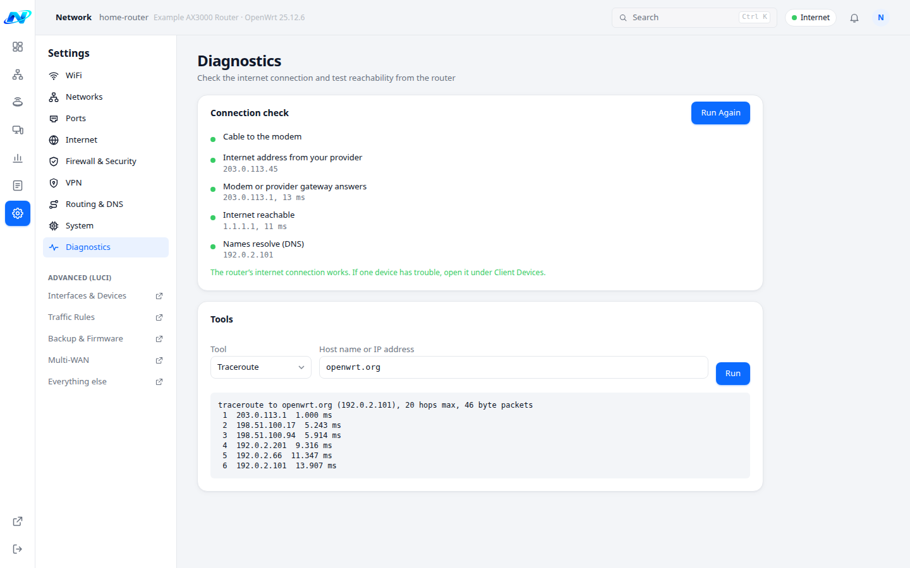

**A website does not work since I turned on ad blocking.** Add the site's
name under **Never block** (Firewall & Security → Ad Blocking & Filtering).

**Something netui does not cover.** Open LuCI from the menu under your
initial (top right), or from **Settings → Advanced (LuCI)**.

**Everything is broken.** Restore your last backup (Settings → System →
Backup). If you cannot reach the router at all, OpenWrt's failsafe mode and
reset are described at
[openwrt.org/docs/guide-user/troubleshooting/failsafe_and_factory_reset](https://openwrt.org/docs/guide-user/troubleshooting/failsafe_and_factory_reset).

---

## Glossary

**Access point.** A device that sends out WiFi for your network. Your router
is one; you can add more for better coverage.

**Band (2.4 GHz / 5 GHz).** WiFi radio frequencies. 2.4 GHz reaches further
through walls; 5 GHz is faster at shorter range.

**Channel.** A slice of a band. Neighbouring WiFi on the same channel slows
yours down.

**DHCP.** How devices get an address automatically when they join the
network.

**DNS.** The internet's phone book: it turns names like example.com into
addresses. Ad blocking and content filtering work through DNS.

**Firewall.** Rules that decide what may reach what: for example, the
internet may not reach your devices unless you forward a port.

**IP address.** A device's address on a network, like `192.168.1.23`.

**LAN.** Your own (local) network at home.

**LuCI.** OpenWrt's built-in settings pages, for everything netui does not
show.

**Mesh.** Access points connecting to each other over WiFi instead of a
cable.

**OpenWrt.** The free router software netui runs on.

**Port forwarding.** Letting a specific kind of traffic from the internet
through to one device at home.

**SSID.** The name of a WiFi network.

**VPN.** A secure tunnel from a device far away into your home network.

**WAN.** Your router's connection to the internet.
